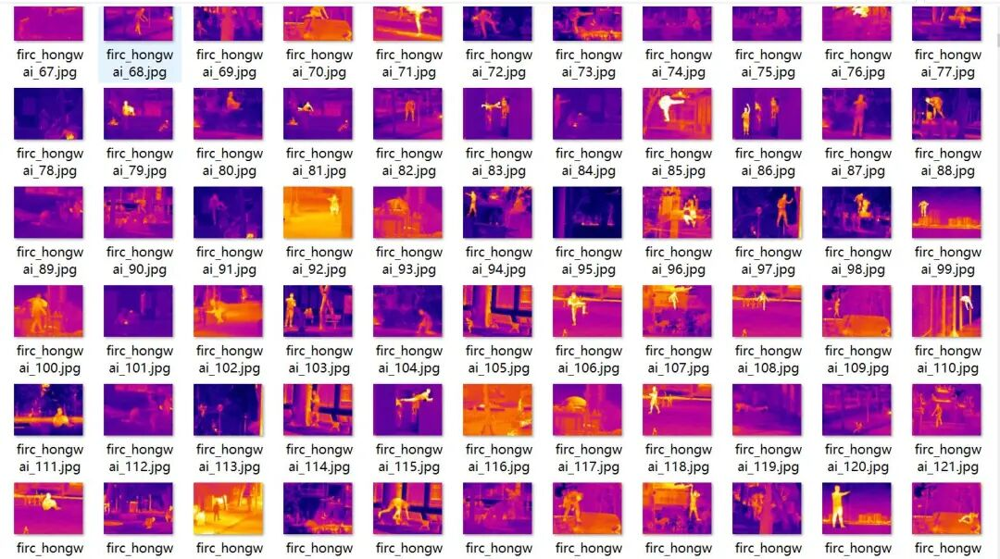
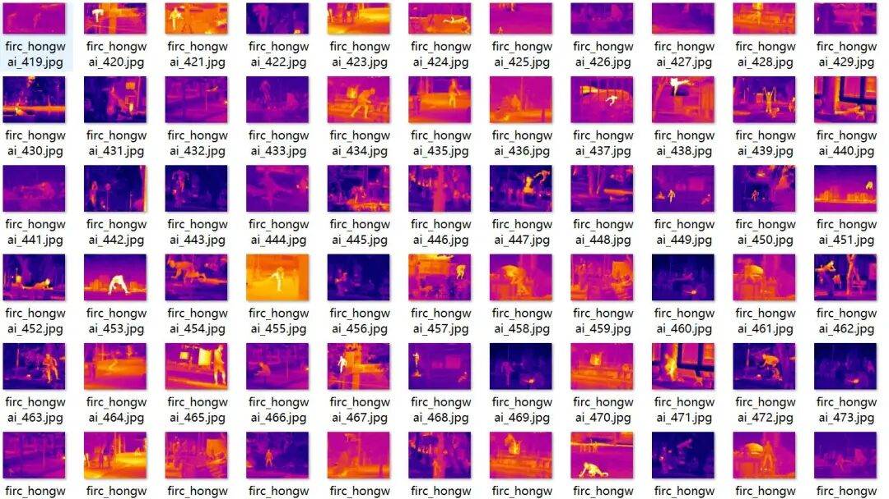
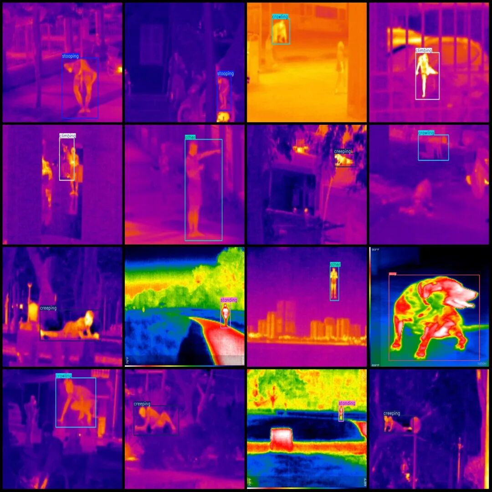

# Infrared Image Personnel Intrusion Detection Dataset VOC+YOLO format with 2685 images in 7 categories

Dataset format: Pascal VOC format + YOLO format (txt file without split path, only containing jpg images and corresponding VOC format xml files and yolo format txt files)

Number of images (number of jpg files): 2685

Number of annotations (number of xml files): 2685

Number of annotations (number of txt files): 2685

Label category count: 7

Label category names (note that the order of yolo format categories does not correspond to this, but is based on the labels folder's classes.txt): ["climbing", "crawling", "creeping", "dog", "other", "standing", "stooping"]

Number of boxes labeled in each category:

Climbing Frames = 587

Crawling Frames = 429

Creep Frame Count = 405

Dog Frames = 117

Other frame count = 583

Number of standing frames = 140

Number of stooping frames = 496

Total frame count: 2757

Using labelImg:

Image resolution: 640x480

Annotation rules: Draw a rectangle around the category.

Important Notice: No

Special : This dataset does not guarantee the accuracy of the trained models or weight files.

Image Preview:

Annotation example:

## Payment

Here is a pay link on Stripe ( https://buy.stripe.com/3cs8yP7sY87d0vu9AB ). Please contact me lonlonago@foxmail.com after funding $89, and I will send you a complete data files , thank you!

